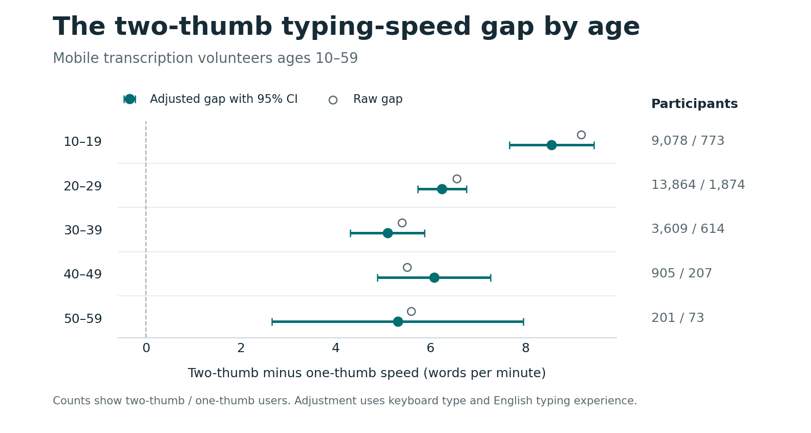

# Does the two-thumb typing gap vary with age?

## Question and sample

I estimate whether the speed gap between two-thumb and one-thumb typists differs across ages, conditional on reported keyboard type and English typing experience. The analysis uses the public Typing37K participant data from Palin et al. (2019). The outcome is participant-average words per minute (WPM) in an English transcription task. [Paper](https://doi.org/10.1145/3338286.3340120) · [Replication report](replication.md)

Of the 37,370 cleaned records, 37,053 are ages 10–59 and 31,198 in that age range reported either two thumbs or one thumb. I pool left and right one-thumb users. The extreme age bands have only eight and six one-thumb typists, so I restrict the primary analysis to five decades from 10–19 to 50–59. All 31,198 eligible participants have the required model fields. I follow the authors’ convention of coding blank English typing frequency as native English. Reported keyboard type is separate from keyboard layout and from the recorded device field. [Sample audit](../results/tables/extension_sample_audit.csv)

## Empirical strategy

I fit participant-level ordinary least squares with five age bands, a two-thumb indicator, their interactions, and categorical terms for reported keyboard type and English typing experience. The reference group uses one thumb and is aged 20–29. The adjusted gap at 20–29 is the two-thumb coefficient. Each other band’s gap adds the corresponding interaction coefficient. I use HC3 covariance for pointwise 95% confidence intervals and for a joint F test that all four interaction coefficients equal zero.

## Results

| Age | One thumb | Two thumbs | Raw gap (WPM) | Adjusted gap (WPM) | HC3 95% CI |
| --- | ---: | ---: | ---: | ---: | ---: |
| 10–19 | 773 | 9,078 | 9.18 | 8.56 | [7.66, 9.45] |
| 20–29 | 1,874 | 13,864 | 6.56 | 6.25 | [5.74, 6.75] |
| 30–39 | 614 | 3,609 | 5.40 | 5.09 | [4.31, 5.88] |
| 40–49 | 207 | 905 | 5.51 | 6.07 | [4.89, 7.26] |
| 50–59 | 73 | 201 | 5.60 | 5.31 | [2.65, 7.96] |

The joint test rejects equal gaps across age bands, with F(4, 31,178) = 8.57 and *p* = 6.63 × 10⁻⁷. Ages 10–19 have the largest estimated gap. Adult estimates range from 5.09 to 6.25 WPM, and the sequence varies across decades. Ages 50–59 have the widest interval, with only 73 one-thumb users. [Age-band contrasts](../results/tables/extension_age_gaps.csv) · [Interaction tests](../results/tables/extension_interaction_tests.csv)

| Sensitivity specification | N | Adjusted gap at 10–19 (WPM) | Joint interaction *p* |
| --- | ---: | ---: | ---: |
| Primary | 31,198 | 8.56 | 6.63 × 10⁻⁷ |
| Add keyboard layout controls | 31,198 | 8.18 | 7.83 × 10⁻⁷ |
| Restrict to reported mobile keyboards | 28,944 | 8.60 | 2.82 × 10⁻⁶ |
| Compare against the other five named postures | 33,524 | 7.66 | 6.28 × 10⁻¹¹ |

The gap for ages 10–19 is the largest in each sensitivity model. Pooling other named postures changes the comparison population, so the resulting contrast answers a broader question. [All model contrasts](../results/tables/extension_age_gaps.csv)

## Interpretation

These estimates describe conditional associations in a volunteer sample. Participants chose and reported their own posture. Typing practice, device features, and prior skill may differ within the same age, keyboard, and English experience categories. The study measures copying English sentences and provides evidence about that task and sample. A study that assigns posture within participant would address the effect of switching posture.
