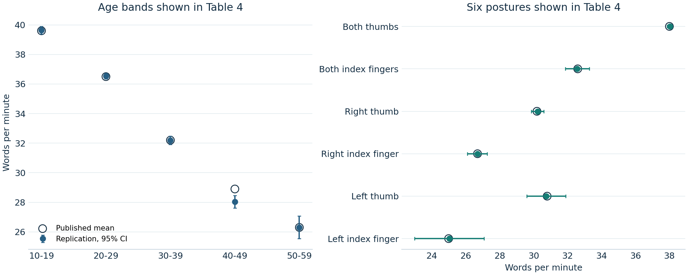

# Replication of Palin et al. (2019)

## Research question and design

Palin and colleagues asked how quickly and accurately people type on mobile devices and how performance varies with demographics, typing posture, and intelligent text entry. Volunteers recruited through an online typing-test website transcribed 15 English sentences in a browser on their own devices. The researchers calculated performance measures from the task and collected posture and experience by questionnaire. The analysis below starts from the public processed participant table, which contains the participant-level performance measures. [Published paper](https://www.pokristensson.com/pubs/PalinEtAlMobileHCI2019.pdf) · [Aalto data and code](https://userinterfaces.aalto.fi/typing37k/)

The public CSV starts with 37,606 distinct participant records. Following the final filters in the authors’ notebook removes 176 unspecified postures, 52 incomplete hand or finger responses, and eight numeric daily typing times outside 0–24 hours. These are sequential counts. The other final filters remove zero additional records. Unparseable typing-time answers stay in the WPM sample. The public participant table lacks the geographic data used to construct the U.S. subsample, so the benchmark comparisons use the paper’s full-sample columns. [Sample audit](../results/tables/sample_flow.csv) · [Authors’ notebook](https://userinterfaces.aalto.fi/typing37k/resources/python_analysis.ipynb)

## Performance and group comparisons

| Measure | Paper mean (SD) | Reproduced mean (SD) |
| --- | ---: | ---: |
| Words per minute | 36.17 (13.22) | 36.17 (13.22) |
| Uncorrected error (%) | 2.34 (2.08) | 2.34 (2.08) |
| Keystrokes per character | 1.18 (0.18) | 1.18 (0.18) |
| Backspaces per sentence | 1.89 (1.96) | 1.89 (1.96) |

All four mean and sample SD pairs in Table 3 agree at the published precision. The WPM 75th percentile is 43.98. The error-rate 75th percentile is 3.06%, compared with 3.07% in the paper’s prose. [Table 3 results](../results/tables/replication_table_3_performance.csv) · [Distributions](../results/figures/replication_performance_distributions.png)

The Table 4 analysis compares WPM distributions using Kruskal–Wallis and two-sided asymptotic Mann–Whitney U tests, with Holm adjustment within each family. Signed Cohen’s *d* is the first group’s mean minus the second group’s mean, divided by the pooled sample SD. The seven age bands and six named posture groups reproduce the supplement’s omnibus statistics, with H = 2,828.35 and H = 2,204.22 respectively. The age omnibus includes the 0–9 and 60–69 bins used in the supplement. Table 4 prints the five bins from 10–19 to 50–59. The cleaned data include ages 6–61. [Table 4 results](../results/tables/replication_table_4_demographics.csv) · [Omnibus tests](../results/tables/replication_omnibus_tests.csv) · [Pairwise tests](../results/tables/replication_pairwise_tests.csv) · [Supplement](https://userinterfaces.aalto.fi/typing37k/resources/supplement.pdf)

- Ages 10–19 were fastest at 39.63 WPM. Ages 40–49 averaged **28.05 WPM** in the release, compared with **28.9** in Table 4. The omnibus test supports differences across age groups. The 50–59 versus 60–69 comparison has Holm-adjusted *p* = 0.601.
- Two-thumb typists were fastest among the six named postures at 38.03 WPM. They accounted for **74.35%** of all participants and **82.33%** of the 33,749 participants in those six groups. State the denominator when reporting either share.
- People coded as native English typists averaged 37.80 WPM, and people who reported never typing in English averaged 25.65 WPM. The training comparison was small at 0.71 WPM in favor of respondents without desktop touch-typing training (Cohen’s *d* = 0.054).

The notebook’s adjustment multiplies ranked raw p-values by the number of remaining tests. Standard Holm additionally takes a cumulative maximum and caps adjusted p-values at one. Test sidedness and implementation also affect published versus reproduced p-values. The CSVs use the standard procedure. A p-value displayed as zero underflowed at machine precision. [Authors’ notebook](https://userinterfaces.aalto.fi/typing37k/resources/python_analysis.ipynb)

## Intelligent text entry

I compared the released gesture, prediction, and autocorrection ratios with the full-sample columns in Tables 5 and 6. Following the notebook, I assigned the eight groups before applying its gesture-to-prediction reassignment for participants who did not report swipe typing. One participant has missing ratios for all three methods. The notebook convention assigns zero to those ratios. For the correlation comparison, I computed Pearson correlations across the full sample, including zeros, and reported both released and recoded ratios. The notebook does not provide the Table 6 matrix code.

| WPM comparison | Published | Reproduced |
| --- | ---: | ---: |
| Autocorrection only, mean WPM | 43.4 | 43.75 |
| Prediction only, mean WPM | 32.8 | 33.29 |
| No detected method, mean WPM | 34.8 | 34.86 |
| Autocorrection ratio, Pearson *r* | +0.237 | +0.226 |
| Prediction ratio, Pearson *r* | −0.183 | −0.227 |

The positive autocorrection and negative prediction associations reproduce in direction. Their magnitudes and several group means differ. For example, autocorrection plus gesture averages 40.22 WPM in the public release compared with 33.8 in the paper. These estimates depend on how observed typing actions are classified. [Table 5 results](../results/tables/replication_table_5_ite_groups.csv) · [Table 6 results](../results/tables/replication_table_6_ite_correlations.csv)

## Implications for the original project

The published age and posture comparisons are marginal summaries. A large average two-thumb gap can coexist with very different gaps within age bands. That motivated a model with an age-by-posture interaction and controls for reported keyboard type and English typing experience. The differences in published and reproduced denominators also motivated an explicit comparison group and a sample audit for each model. [Original research report](extension.md)
